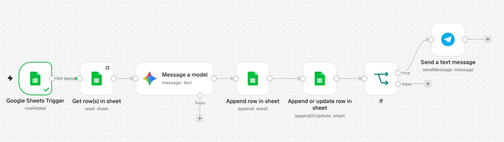
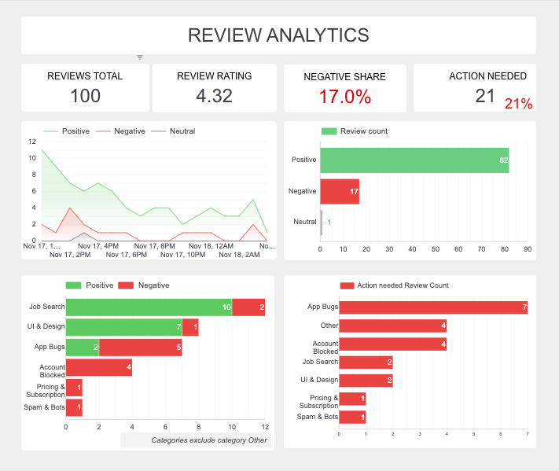
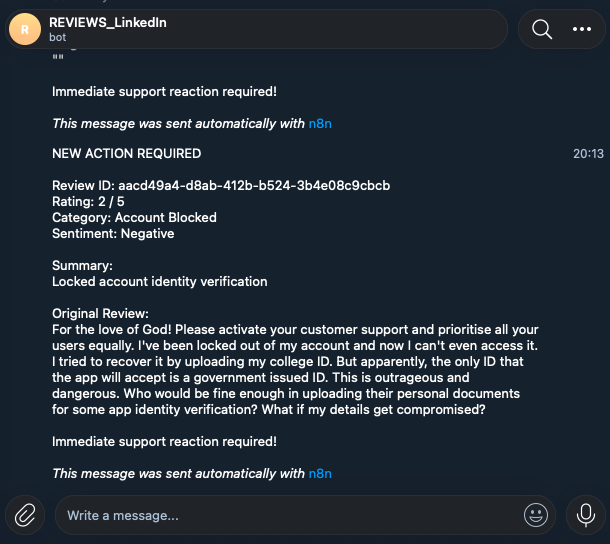

# Automated LLM Review Monitoring & Analytics Pipeline

An end-to-end automated system built with **n8n**, **Google Sheets**, **Google Gemini AI**,**Looker Studio (Google Data Studio)**, and **Telegram Bot API** to analyze customer feedback in real-time, detect sentiment, categorize issues, and immediately trigger action alerts for critical support cases.

 

---

## Business Overview & Impact

Monitoring incoming user reviews manually is slow and prone to delayed support reactions. This project solves that problem by building an event-driven AI workflow that:
1. **Automates Data Processing:** Automatically ingests new user feedback from Google Sheets.
2. **Performs AI Analysis:** Uses Google Gemini LLM to extract sentiment, detect issue categories, summarize the core problem, and flag whether immediate intervention is needed (`action_needed = Yes/No`).
3. **Triggers Real-Time Action Alerts:** Immediately dispatches formatted critical alerts directly to a designated Telegram support channel.
4. **Tracks KPIs via BI Dashboard:** Aggregates feedback metrics into a clean dashboard to track rating trends, sentiment distribution, and bug drivers.

---
## Dataset & Source

* **Dataset Source:** Real-world mobile app review data sourced from [Kaggle: 320K LinkedIn App Google Store Reviews](https://www.kaggle.com/).
* **Data Context:** Authentic user feedback containing app ratings, category distribution, user complaints, and operational app issues.

---

## Analytics Dashboard (Looker Studio)

 

### Key Metrics & Insights:
* **Total Reviews Processed:** 100
* **Average Review Rating:** 4.32 / 5.0
* **Negative Sentiment Rate:** 17.0%
* **Action Required Rate:** 21.0% (21 reviews flagged for urgent support intervention)
* **Top Escalation Drivers:** `App Bugs` (7 cases) and `Account Blocked` (4 cases) account for the majority of urgent support alerts.

---

## Architecture & Key Components

* **n8n (Workflow Automation):** Connects the data sources, structures inputs/outputs, handles conditional routing, and executes automated flows.
* **Google Sheets API:** Serves as the primary review data repository and event trigger (`Row Added`).
* **Google Gemini LLM:** Evaluates text sentiment (`Positive / Negative / Neutral`), maps issues to defined categories (`App Bugs`, `Account Blocked`, `UI & Design`, `Job Search`, `Spam & Bots`, `Pricing & Subscription`, `Other`), generates a concise 3–5 word summary in English, and evaluates action necessity (`Yes / No`) via a strictly formatted JSON prompt.
* **Telegram Bot API:** Delivers immediate, structured alerts for critical negative reviews requiring urgent support reaction.

---

## Telegram Alert Example

 

```text
How to Import & Run

Download the json_code file from this repository.
In your n8n instance, click Workflows -> Import from File.
Configure your credentials for:
Google Sheets API
Google Gemini API Key
Telegram Bot Token & Chat ID
Activate the workflow (Active mode) to process incoming rows automatically.
